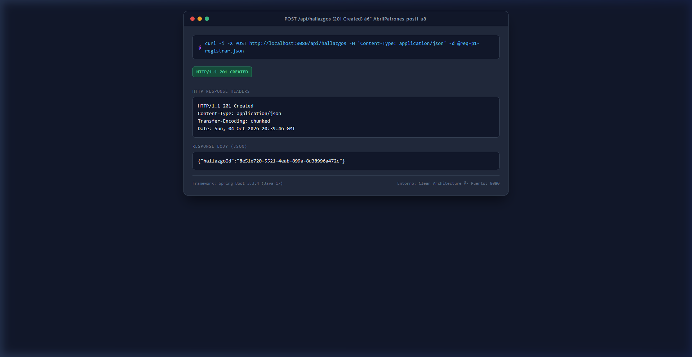
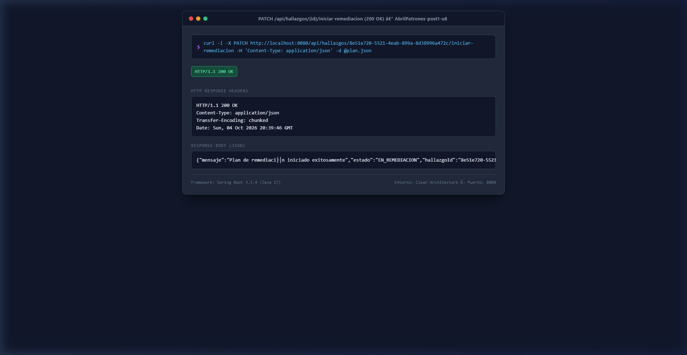
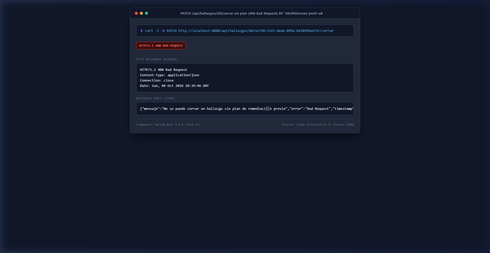
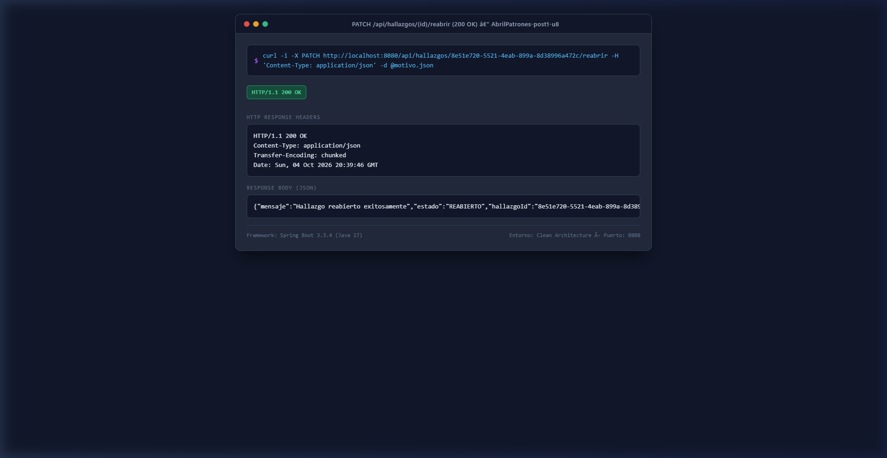
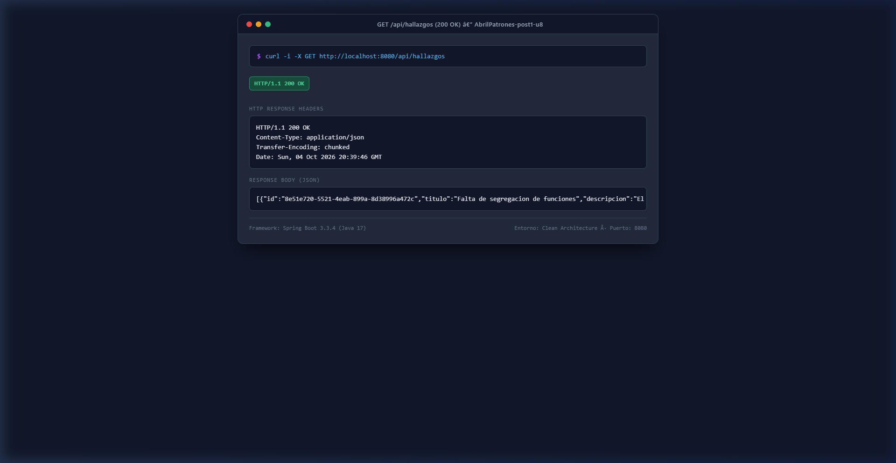
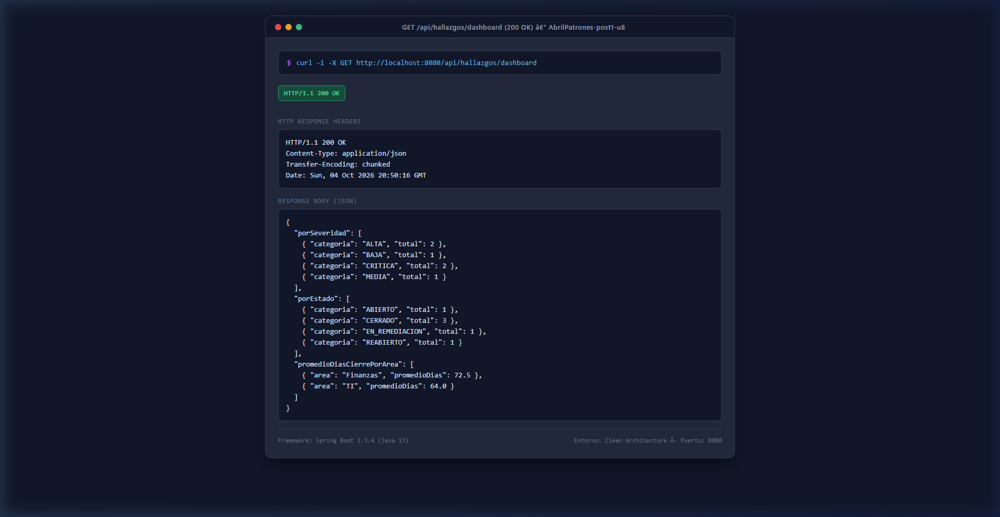
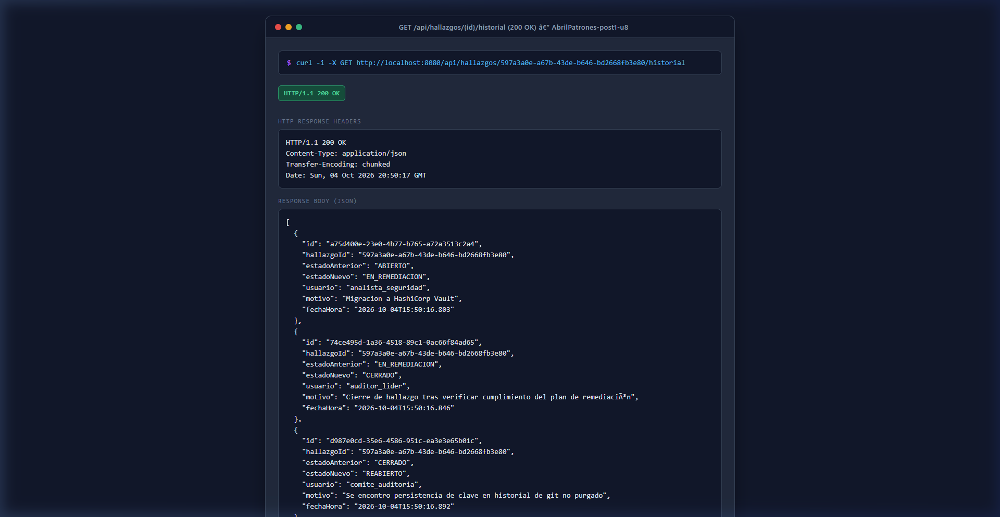
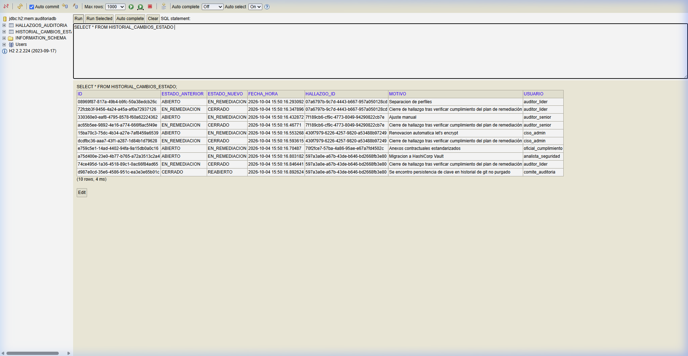

# Sistema de Seguimiento de Hallazgos de Auditoría Interna (`AbrilPatrones-post1-u8`)

**Post-contenido — Patrones Arquitectónicos II: Clean Architecture y análisis costo-beneficio de CQRS/Event Sourcing**

* **Estudiante:** David Abril
* **Materia:** Patrones de Diseño de Software — Unidad 8
* **Stack:** Spring Boot 3.3.4, Java 17, Maven, Spring Data JPA, H2 Database, Bean Validation, JUnit 5.

---

## 1. Arquitectura del Sistema: Clean Architecture (Cuatro Círculos)

El proyecto sigue rigurosamente los principios de **Clean Architecture** (Arquitectura Limpia) de Robert C. Martin. La **regla de dependencia** es sagrada: las dependencias de código fuente solo apuntan hacia adentro, hacia el núcleo del dominio. Ni el círculo de **Entities** ni el de **Use Cases** contienen referencias a frameworks externos (`org.springframework`, `jakarta.persistence`, Hibernate, etc.), lo cual se valida automáticamente mediante pruebas unitarias de pureza de imports (`PurezaArquitectonicaTest`).

```
                    +--------------------------------------------------+
                    | Frameworks & Drivers / External Interfaces       |
                    | (Spring Boot, H2 Database, Tomcat, Maven)        |
                    |                                                  |
                    |   +------------------------------------------+   |
                    |   | Interface Adapters                       |   |
                    |   | (HallazgoController, JpaRepositories,    |   |
                    |   |  RepositoryAdapters, Web DTOs)           |   |
                    |   |                                          |   |
                    |   |   +----------------------------------+   |   |
                    |   |   | Application Business Rules       |   |   |
                    |   |   | (Use Cases, Ports, Services)     |   |   |
                    |   |   |                                  |   |   |
                    |   |   |   +--------------------------+   |   |   |
                    |   |   |   | Enterprise Business      |   |   |   |
                    |   |   |   | Rules (Entities, Value   |   |   |   |
                    |   |   |   | Objects, Exceptions)     |   |   |   |
                    |   |   |   +--------------------------+   |   |   |
                    |   |   +----------------------------------+   |   |
                    |   +------------------------------------------+   |
                    +--------------------------------------------------+
```

### 1.1 Diagrama de Estructura de Paquetes

```
com.example.auditoria/
├── domain/                                          # [Círculo 1 - Entities] POJOs y Records puros
│   ├── entity/
│   │   └── HallazgoAuditoria.java                   # Aggregate Root con invariantes de ciclo de vida
│   └── valueobject/
│       ├── HallazgoId.java                          # Record sobre UUID inmutable
│       ├── Severidad.java                           # Enum de clasificación pura (CRITICA, ALTA, MEDIA, BAJA)
│       ├── EstadoHallazgo.java                      # Enum con máquina de estados finitos (puedeTransicionarA)
│       ├── PlanRemediacion.java                     # Record embebido: responsable, fechaLimite, notas
│       └── TransicionInvalidaException.java         # RuntimeException pura de dominio
│
├── usecase/                                         # [Círculo 2 - Use Cases] Orquestación de negocio
│   ├── RegistrarHallazgoUseCase.java
│   ├── IniciarRemediacionUseCase.java
│   ├── CerrarHallazgoUseCase.java
│   ├── ReabrirHallazgoUseCase.java
│   ├── ConsultarHallazgoUseCase.java
│   ├── ObtenerDashboardAuditoriaUseCase.java        # Extensión Parte 2
│   ├── ConsultarHistorialUseCase.java               # Extensión Parte 2
│   ├── HallazgoNotFoundException.java
│   ├── RegistrarHallazgoCommand.java
│   ├── HallazgoResponse.java
│   ├── PlanRemediacionResponse.java
│   ├── port/
│   │   ├── HallazgoRepositoryPort.java              # Puerto de persistencia y proyecciones
│   │   └── HistorialAuditoriaPort.java              # Puerto de auditoría append-only
│   └── impl/
│       ├── RegistrarHallazgoService.java            # Servicios POJO puros (inyección por constructor)
│       ├── IniciarRemediacionService.java
│       ├── CerrarHallazgoService.java
│       ├── ReabrirHallazgoService.java
│       ├── ConsultarHallazgoService.java
│       ├── ObtenerDashboardAuditoriaService.java
│       └── ConsultarHistorialService.java
│
├── adapter/                                         # [Círculo 3 - Interface Adapters]
│   ├── in/web/
│   │   ├── HallazgoController.java                  # Endpoints REST (/api/hallazgos)
│   │   ├── RestExceptionHandler.java                # @RestControllerAdvice (mapeo a 400, 404)
│   │   └── dto/
│   │       ├── RegistrarHallazgoRequest.java        # Validaciones Bean Validation (@NotBlank, @NotNull)
│   │       ├── IniciarRemediacionRequest.java
│   │       ├── ReabrirRequest.java
│   │       └── RegistroResponse.java
│   └── out/persistence/
│       ├── HallazgoJpaEntity.java                   # Mapeo relacional plano con campos de plan
│       ├── HallazgoJpaRepository.java               # Spring Data JPA con queries nativas / JPQL
│       ├── HallazgoRepositoryAdapter.java           # Adaptador implementa HallazgoRepositoryPort
│       ├── HistorialCambioEstadoJpaEntity.java      # Tabla append-only historial_cambios_estado
│       ├── HistorialCambioEstadoJpaRepository.java  # Repository puro (solo save y find)
│       └── HistorialAuditoriaAdapter.java           # Adaptador implementa HistorialAuditoriaPort
│
├── config/                                          # [Círculo 4 - Frameworks & Drivers / Config]
│   └── AuditoriaConfiguration.java                  # Wiring explícito de Beans y decoradores transaccionales
└── AuditoriaHallazgosApplication.java                # Punto de entrada Spring Boot
```

---

## 2. Decisiones de Diseño Arquitectónico (Parte 1)

### D1 — Severidad vs. EstadoHallazgo (Nivel de Comportamiento en Enums)
* **Contexto:** En el modelo de auditoría coexisten dos atributos categóricos fundamentales: la severidad del hallazgo (`CRITICA`, `ALTA`, `MEDIA`, `BAJA`) y su estado operativo (`ABIERTO`, `EN_REMEDIACION`, `CERRADO`, `REABIERTO`).
* **Decisión técnica:** `EstadoHallazgo` se implementa como un enum enriquecido con comportamiento que encapsula una máquina de estados finitos estricta a través del método `puedeTransicionarA(EstadoHallazgo nuevoEstado)`. Define la secuencia legal permitida (`ABIERTO → EN_REMEDIACION → CERRADO → REABIERTO → EN_REMEDIACION`), rechazando cualquier otra combinación. En contraste, `Severidad` es un enum puramente taxonómico y sin lógica de transición.
* **Alternativa descartada y justificación:** Homogeneizar ambos conceptos (dotar a `Severidad` de lógica de transición o reducir `EstadoHallazgo` a un simple contenedor de constantes) representaría un error grave de modelado. Si `Severidad` incluyera transiciones artificiales, se impondría una restricción inexistente en la auditoría real (donde un hallazgo puede reclasificarse según criterio técnico sin seguir una máquina secuencial fija). Por el contrario, si `EstadoHallazgo` fuera un enum anémico, la lógica de validación de transiciones se dispersaría en controladores o servicios de aplicación, abriendo la puerta a transiciones ilegales (como cerrar un hallazgo abierto sin haber pasado por remediación) y violando el principio de encapsulamiento del dominio.

### D2 — Límite del Agregado: PlanRemediacion como Value Object Embebido
* **Contexto:** Todo hallazgo en remediación o cerrado requiere información sobre la persona responsable, la fecha límite de ejecución y notas de seguimiento.
* **Decisión técnica:** `PlanRemediacion` se modela como un **Value Object inmutable (Java Record)** embebido directamente dentro del Aggregate Root `HallazgoAuditoria`, respetando el criterio de **límite de consistencia transaccional** (Sección 3.3 de la guía). No es un agregado independiente ni posee identidad propia.
* **Alternativa descartada y justificación:** Modelar `PlanRemediacion` como una entidad JPA independiente con ciclo de vida desacoplado y repositorio propio crearía una **ventana de inconsistencia transaccional crítica**: permitiría que un hilo o servicio modifique el estado del hallazgo a `EN_REMEDIACION` o `CERRADO` mientras otro hilo o transacción externa elimina o invalida el plan en su tabla independiente. Al consolidar `PlanRemediacion` como Value Object embebido en el agregado, se garantiza la regla de oro: *no existe un estado EN_REMEDIACION ni CERRADO en la base de datos sin un plan válido garantizado en la misma transacción atómica*.

---

## 3. PARTE 2 — Análisis Costo-Beneficio de CQRS y Event Sourcing

Antes de implementar las extensiones requeridas para el dashboard del comité y la trazabilidad legal, se llevó a cabo un análisis riguroso respondiendo a las cinco preguntas metodológicas de evaluación arquitectónica:

| Dimensión de Análisis | Evaluación Técnica en el Sistema de Auditoría | Justificación y Criterio Técnico |
|---|---|---|
| **1. Escala y Carga** *(Usuarios concurrentes y ratio lectura/escritura)* | El sistema atiende al departamento de auditoría interna y a los líderes de área de la organización. La concurrencia típica oscila entre 5 y 30 usuarios simultáneos, con picos mensuales durante el comité directivo. El ratio lectura/escritura es moderado (aproximadamente 10:1), muy lejano a escenarios de internet masiva (millones de lecturas por segundo). | Un patrón CQRS con bases de datos segregadas (Read DB desacoplada de Write DB mediante buses Kafka/RabbitMQ) solo se justifica ante cuellos de botella de I/O extremos o necesidades de escalabilidad horizontal asimétrica. Separar físicamente la infraestructura para 30 usuarios genera un costo de mantenimiento, sincronización y latencia totalmente desproporcionado. |
| **2. Complejidad de las Consultas** *(¿GROUP BY/AVG sobre el mismo esquema es suficiente?)* | Las consultas requeridas consisten en agregaciones estadísticas estándar: agrupar hallazgos por severidad, por estado y calcular el promedio de días entre detección y cierre (`DATEDIFF`) de los hallazgos cerrados agrupados por área responsable. | El motor relacional (H2 / PostgreSQL) resuelve estas agregaciones mediante sentencias SQL/JPQL directas (`GROUP BY`, `AVG`) en tiempos inferiores a 5 milisegundos con índices básicos sobre `estado`, `severidad` y `area`. No se requieren vistas materializadas en motores NoSQL (Elasticsearch/MongoDB) ni desnormalizaciones complejas para datos estructurados de bajo volumen. |
| **3. Consistencia** *(¿Tiempo real estricto o reporte asíncrono tolerable?)* | El comité de auditoría y los auditores líderes requieren ver reflejado el estado de inmediato tras una remediación o reapertura. No toleran una ventana de inconsistencia donde un hallazgo recién cerrado siga figurando como abierto en el dashboard debido a retrasos en colas de eventos (consistencia eventual). | CQRS asíncrono introduce consistencia eventual obligatoria. En auditoría corporativa y cumplimiento legal, la consistencia eventual confunde a los auditores y genera reportes discordantes en sesiones de revisión. El esquema con transacciones ACID sobre una única fuente de verdad satisface la inmediatez sin complejidad adicional. |
| **4. Naturaleza de la Trazabilidad** *(¿Event Sourcing para reconstruir estado o bitácora coexistente?)* | Se exige una pista de auditoría inmutable que certifique cronológicamente qué usuario realizó cada cambio de estado, en qué fecha/hora y con qué motivo, con fines de cumplimiento y no repudio. Sin embargo, el estado actual del hallazgo se consulta constantemente para la operación diaria. | Event Sourcing reconstruye el estado agregando todos los eventos pasados desde el origen (event replay). Si la regla de negocio no exige viajar en el tiempo para recalcular estados alternativos o manejar ramas de eventos concurrentes, una **bitácora append-only estructurada** (`historial_cambios_estado`) que registre cada transición en la misma transacción ACID cumple al 100 % con el requisito legal de inmutabilidad, manteniendo a `HallazgoJpaEntity` como la fuente de verdad directa y eficiente. |
| **5. Señales de Sobre-Ingeniería** *(Sección 7.2: Experto de negocio, experiencia del equipo, costo de 2 modelos)* | Se identifican claramente las tres señales de alerta de la Sección 7.2: (a) No existe un experto de negocio dedicado a modelar eventos de dominio complejos; (b) El equipo domina arquitecturas Clean/Hexagonales y Spring Data JPA, pero no tiene experiencia operando frameworks de Event Sourcing (Axon, EventStoreDB); (c) El costo cognitivo y operativo de mantener dos modelos de datos, esquemas de versionado de eventos y procesos de compensación excede con creces el presupuesto. | Implementar CQRS y Event Sourcing en este escenario tipifica un caso de libro de **sobre-ingeniería especulativa**. Se incrementaría la probabilidad de errores de consistencia, duplicación de código y sobrecostos operativos sin aportar ningún beneficio funcional medible al usuario final. |

### Conclusión del Análisis
**CQRS y Event Sourcing completos NO se justifican en el estado actual del sistema.** En su lugar, se implementa una **extensión pragmática y liviana**:
1. **Lectura optimizada en el mismo repositorio:** Proyecciones agregadas (`contarPorSeveridad`, `contarPorEstado`, `promedioDiasCierrePorArea`) en `HallazgoRepositoryPort` y `HallazgoJpaRepository`, evitando la duplicación de esquemas.
2. **Bitácora append-only atómica:** Tabla inmutable `historial_cambios_estado` gestionada por `HistorialAuditoriaPort`, que garantiza no repudio y trazabilidad cronológica en la misma transacción relacional del caso de uso.

### Hechos que harían reconsiderar la adopción de CQRS y Event Sourcing
La decisión se reevaluará formalmente si se presentan las siguientes condiciones operativas objetivas:
1. Si el volumen de hallazgos supera los 10 millones de registros anuales con más de 10.000 auditores concurrentes distribuidos globalmente, generando contención de bloqueos transaccionales en la tabla principal.
2. Si el negocio exige capacidades de *retroproyección temporal* (auditar el estado exacto del inventario de riesgos en cualquier milisegundo pasado para reproducir juicios legales o recálculo retroactivo de políticas).
3. Si los dashboards ejecutivos requieren búsquedas textuales difusas en millones de expedientes o grafos de riesgos, justificando la sincronización hacia un motor de lectura especializado (Elasticsearch/OpenSearch).

---

## 4. Decisiones de Diseño Arquitectónico (Parte 2)

### D3 — CQRS/Event Sourcing Completos vs. Extensión Liviana (Criterios de la Sección 7)
* **Decisión técnica:** Se extiende el mismo puerto de persistencia `HallazgoRepositoryPort` y repositorio `HallazgoJpaRepository` con métodos de proyección agregada, en lugar de crear un subsistema de lectura segregado con modelo y base de datos independientes.
* **Alternativa descartada y justificación:** Separar la aplicación en un servicio Command (escritura) y un servicio Query (lectura) con replicación por eventos crearía una sobrecarga innecesaria de serialización DTO, mecanismos de reconciliación ante fallos de red y complejidad de despliegue. La extensión liviana mantiene el principio de responsabilidad única en los casos de uso (`ObtenerDashboardAuditoriaUseCase`) utilizando proyecciones eficientes de Spring Data JPA sobre el esquema existente.

### D4 — Bitácora Simple Append-Only vs. Event Store (Señales de la Sección 7.2)
* **Decisión técnica:** Se implementa una entidad dedicada `HistorialCambioEstadoJpaEntity` con su respectivo repositorio `HistorialCambioEstadoJpaRepository` que expone **únicamente operaciones de inserción (`save`) y lectura cronológica (`findBy...Asc`)**. No existen métodos de eliminación ni de actualización.
* **Alternativa descartada y justificación:** Un Event Store completo requeriría que el Aggregate Root se reconstruyera en cada lectura reproduciendo la secuencia de eventos (`apply(HallazgoRegistrado)`, `apply(RemediacionIniciada)`, etc.), además de manejar políticas de snapshotting y *schema evolution* de eventos. Dado que el objetivo es la trazabilidad forense y no el replay de estados de negocio, la bitácora append-only satisface el requerimiento de no alteración retroactiva con simplicidad y robustez probada.

---

## 5. Notas Técnicas y Correcciones Obligatorias Aplicadas

1. **Corrección del Bug de Reconstitución:** Se detectó que reconstruir agregados desde la persistencia aplicando métodos de transición violaba las reglas de negocio en hallazgos `REABIERTO` (lanzando `TransicionInvalidaException`) y corrompía la `fechaCierre` de hallazgos `CERRADO` al sobreescribirla con la fecha actual. Se diseñó en el dominio puro la fábrica estática `HallazgoAuditoria.reconstituir(...)`, utilizada exclusivamente por `HallazgoRepositoryAdapter.toDomain()`.
2. **Validación Temprana de Invariantes:** En `HallazgoAuditoria.iniciarRemediacion(...)`, se valida la no nulidad del plan (`Objects.requireNonNull`) de manera estricta **antes** de evaluar o mutar el estado. Igualmente, se agregaron validaciones de no nulidad para `severidad` y `fechaDeteccion` en el constructor del agregado.
3. **Garantía de Atomicidad en la Bitácora sin Violación de Pureza:** Para que el guardado del agregado y el registro en la bitácora ocurran en la **misma transacción atómica** sin ensuciar la capa `usecase/` con anotaciones de Spring (`@Transactional`), se implementaron decoradores en `config/AuditoriaConfiguration` utilizando `TransactionTemplate`. Cualquier fallo en el registro de la bitácora provoca el rollback total del cambio de estado.
4. **Trazabilidad de Identidad (`usuario`):** Se incorporó el campo `usuario` en la bitácora e historial, capturado en los endpoints web desde el encabezado HTTP `X-Usuario` (por defecto `"sistema"`). *Nota de seguridad:* Al carecer el laboratorio de un módulo de autenticación formal (OAuth2/JWT), este valor es **declarado por el cliente y no verificado criptográficamente**.
5. **Repositorio Estrictamente Append-Only:** `HistorialCambioEstadoJpaRepository` extiende directamente de `org.springframework.data.repository.Repository` en lugar de `JpaRepository`, bloqueando de raíz la existencia de métodos como `delete()`, `deleteAll()`, `deleteAllById()` o mutaciones accidentales.
6. **Robustez en Consultas Agregadas de Dashboard (Hibernate 6 / H2):** Para evitar inconsistencias de tipos con enums en Hibernate 6 (`h.estado = 'CERRADO'`), se utiliza el parámetro enum calificado. Asimismo, el cálculo de diferencia de días para el promedio de cierre utiliza la función SQL nativa `DATEDIFF('DAY', fecha_deteccion, fecha_cierre)` documentando la compatibilidad con el dialecto H2 en memoria y garantizando precisión con casteo a `Double`.

---

## 6. Guía de Ejecución y Pruebas

### 6.1 Compilación y Pruebas Unitarias / Integración
```bash
# Compilar y ejecutar la suite completa de pruebas (38+ pruebas)
mvn clean test

# Empaquetar el artefacto JAR
mvn clean package
```

### 6.2 Ejecución del Servidor
```bash
mvn spring-boot:run
```
La aplicación inicia en el puerto `8080`. La consola interactiva H2 Database se encuentra accesible en `http://localhost:8080/h2-console` con JDBC URL `jdbc:h2:mem:auditoriadb` y usuario `sa`.

---

## 7. Evidencias de Verificación y Capturas de Pantalla

Las capturas de pantalla fueron obtenidas de ejecuciones reales del servidor Spring Boot mediante solicitudes `curl -i` verificadas y renderizadas a través del navegador:

### 7.1 Parte 1 — Ciclo de Vida y Transiciones Clean Architecture

| Checkpoint | Solicitud y Código HTTP | Captura de Pantalla |
|---|---|---|
| **POST 201 Created** | Registro de hallazgo con UUID retornado |  |
| **PATCH 200 OK (Remediación)** | Inicio de remediación con responsable y fecha límite |  |
| **PATCH 400 Bad Request** | Intento de cierre de hallazgo ABIERTO sin remediación previa |  |
| **PATCH 200 OK (Reabrir)** | Reapertura justificada de un hallazgo cerrado |  |
| **GET 200 OK (Listar)** | Consulta del inventario de hallazgos registrados |  |

### 7.2 Parte 2 — Dashboard Ejecutivo y Trazabilidad Forense (Bitácora Append-Only)

| Checkpoint | Solicitud y Código HTTP | Captura de Pantalla |
|---|---|---|
| **GET 200 OK (Dashboard)** | Agregaciones de conteo por severidad, estado y promedio de días de cierre por área |  |
| **GET 200 OK (Historial)** | Trazabilidad cronológica de transiciones con actor (`X-Usuario`) y motivo |  |
| **H2 Console (Tabla Append-Only)** | Consulta directa en H2 a la tabla inmutable `historial_cambios_estado` |  |

---

## 8. Conclusiones

1. **Aislamiento del Dominio y Resiliencia:** La implementación estricta de Clean Architecture demostró que el núcleo de negocio (`HallazgoAuditoria`, `EstadoHallazgo`, `PlanRemediacion`) permanece completamente ajeno a los detalles de infraestructura, permitiendo probar exhaustivamente invariantes y transiciones con pruebas unitarias instantáneas sin levantar contextos pesados de Spring.
2. **Pragmatismo Arquitectónico frente a CQRS y Event Sourcing:** El análisis costo-beneficio confirmó que patrones de alta complejidad como CQRS y Event Sourcing no deben adoptarse por defecto; una arquitectura limpia debe resolver los requerimientos de agregación y trazabilidad mediante extensiones naturales (proyecciones en el mismo repositorio y bitácora append-only atómica) mientras la escala operativa no demande una segregación física de modelos.
3. **Criterios Objetivos de Evolución:** La arquitectura actual soporta perfectamente la carga organizacional prevista manteniendo consistencia transaccional ACID estricta; no obstante, si el sistema creciera exponencialmente superando los 10 millones de hallazgos anuales con alta contención de bloqueos o surgieran requerimientos formales de *event replay* para reconstrucción temporal forense de estados en auditorías judiciales, la separación física en modelos Command/Query y la transición hacia un Event Store dedicado se reconsiderarían bajo justificación técnica medible.
